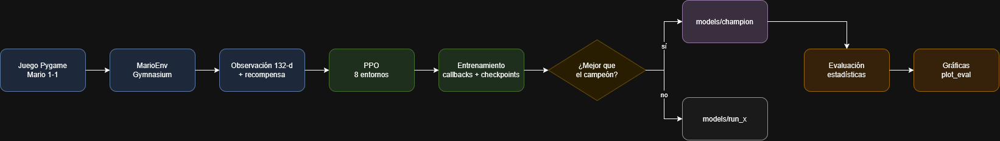
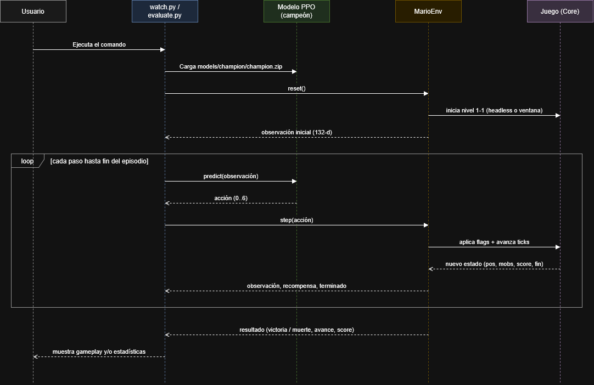
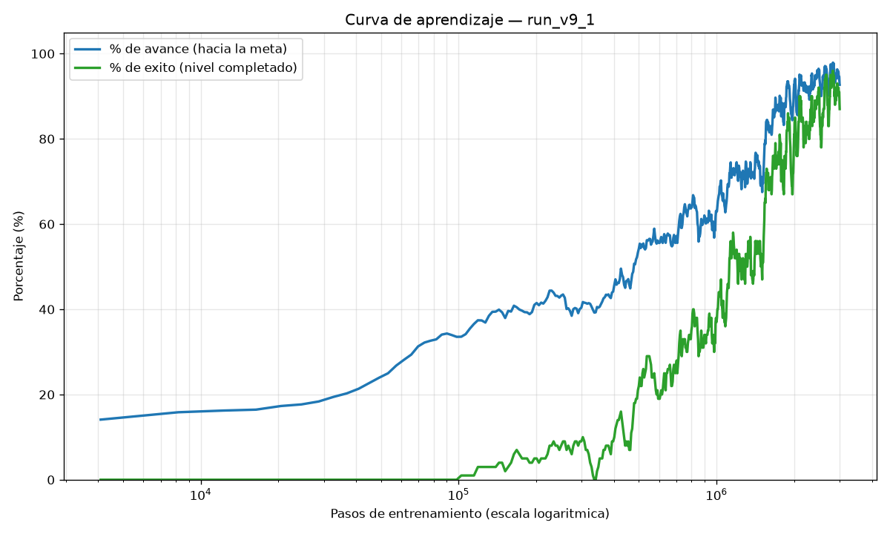

# Proyecto Final I.A

> **Autores:** Alessandro Soccol, Samuel Serna, Paula Arroyave, Alejandro Correa
> **Curso:** Inteligencia Artificial — Universidad EAFIT
> **Fecha:** Noviembre de 2026

Este proyecto desarrolla un agente de inteligencia artificial capaz de completar
de forma autónoma el primer nivel de *Super Mario Bros*. El agente no recibe
ninguna instrucción explícita sobre cuándo saltar o cómo evitar a un enemigo:
partiendo de cero, aprende por sí mismo —a través de sucesivas partidas— a
correr, saltar, esquivar obstáculos y alcanzar la meta. El trabajo se apoya en un
clon del juego implementado en Pygame y en aprendizaje por refuerzo, concretamente
el algoritmo PPO.

---

## 1. Introducción

Los juegos de plataformas constituyen un escenario especialmente exigente para un
agente de inteligencia artificial, pues integran simultáneamente varias
capacidades: la comprensión del espacio, la anticipación de los obstáculos y la
sincronización precisa de cada acción. Un error de apenas unos instantes basta
para que el personaje caiga a un vacío o colisione con un enemigo. Por ello
representan un banco de pruebas idóneo para evaluar la toma de decisiones
secuencial de un agente.

El objetivo central del proyecto fue precisamente ese: lograr que el agente
aprendiera a superar el nivel 1-1 **sin indicaciones previas ni movimientos
codificados manualmente**, basándose únicamente en la observación del estado del
juego y en las recompensas obtenidas.

El valor del trabajo no reside solo en que el personaje alcance la meta, sino en
el proceso completo que lo hace posible: la integración de un juego preexistente
con las herramientas estándar de aprendizaje por refuerzo (Gymnasium)
**modificando una única constante física del juego**, el diseño de una función de
recompensa que evite inducir comportamientos degenerados, y el desarrollo de una
metodología de diagnóstico para identificar las causas del estancamiento del
agente. Cabe destacar que uno de los hallazgos más relevantes no fue de naturaleza
algorítmica, sino del propio juego: se identificó un obstáculo insuperable con la
física original. En conjunto, el proyecto ofrece una base sólida y reproducible
para experimentar con el diseño de recompensas y con la representación del estado.

## 2. Objetivo

**General:** Entrenar un agente de RL capaz de completar el nivel 1-1 de Super
Mario Bros de forma autónoma.

**Específicos:**

1. Construir un entorno Gymnasium que envuelva el juego Pygame, operable
   headless y de forma determinista, que permita entrenar 3 millones de pasos
   con 8 entornos en paralelo en menos de 30 minutos en CPU.
2. Diseñar una función de recompensa con la que el agente avance en promedio
   al menos el 90 % del nivel (≥ 5 700 px de los ≈ 6 336 px hasta la bandera),
   evitando que la política colapse a estrategias pasivas.
3. Alcanzar una tasa de victorias (llegar a la bandera) ≥ 30 % en evaluación
   sobre episodios independientes.

## 3. Descripción de los datos

Este proyecto **no usa un dataset estático**: los datos son la experiencia que el
agente genera al interactuar con el entorno (transiciones estado→acción→
recompensa). La "fuente de datos" es el propio juego, muestreado en cada paso.

**Observación (estado) que recibe el agente** — vector de 132 valores:

| Grupo | Dimensión | Descripción |
|---|---|---|
| Escalares del jugador | 6 | pos. x, pos. y, vel. x, vel. y, en-suelo (0/1), nivel de poder |
| Grid de bloques | 7×9 = 63 | sólidos alrededor de Mario (1 = bloque, 0 = vacío) |
| Grid de mobs | 7×9 = 63 | enemigos (+1), power-ups hongo/flor (−1), nada (0) |

**Acciones** — 7 discretas: nada, derecha, derecha+salto, derecha+correr,
derecha+correr+salto, salto, izquierda.

**Tamaño y formato:** cada transición es un vector `float32` de 132 valores, una
acción entera (0–6) y una recompensa escalar. El agente final se entrenó con
**3 millones de transiciones** (8 entornos en paralelo) y se evaluó con **50
episodios** independientes por agente, guardados en `episodes.csv` (una fila por
episodio) y `summary.json` (resumen).

**Preprocesamiento:** los escalares se normalizan a rangos comparables; las
grillas se construyen centradas en Mario desde la estructura interna del mapa y
la lista de mobs del juego. El tiempo del juego se simula con un reloj
determinista (frame-skip de 4 ticks por acción) para entrenar a máxima velocidad
sin ventana ni audio.

**Limitaciones conocidas:** el nivel 1-1 original del clon contiene un tubo de 4
tiles (128 px) que supera la altura de salto base de Mario (≈101 px con el valor
original `JUMP_POWER=4.3`); el salto base solo corona ese tubo rebotando sobre un
enemigo. Para hacer el nivel superable de forma fiable por el agente se ajustó la
constante física `JUMP_POWER` (ver Metodología). Además, el agente se entrena y
evalúa en un único nivel (1-1), por lo que no se puede afirmar que generalice a
otros niveles.

**Licencia y restricciones de uso:** el código de `rl/` fue desarrollado por el
equipo con fines académicos. El juego (`game/MarioPygame/Next/`) es un clon de
código abierto de terceros y conserva la licencia de su repositorio original.
*Super Mario Bros* es una marca registrada de Nintendo; este proyecto es de uso
exclusivamente académico y sin fines comerciales.

## 4. Metodología

**Etapas del pipeline:**

1. **Entorno (`mario_env.py`):** envuelve el juego en una interfaz Gymnasium.
   Arranca headless, controla a Mario por los flags internos del juego (sin
   eventos de teclado), parchea el reloj para ser determinista y construye
   observación y recompensa en cada paso.
2. **Modelado:** política PPO (`MlpPolicy`, red 64×64 para actor y crítico) de
   Stable-Baselines3, con observación vectorial y acción discreta.
3. **Entrenamiento (`train.py`):** 8 entornos en paralelo, normalización de
   recompensa, callbacks que registran métricas y guardan el mejor modelo, y
   promoción automática a un "campeón global" si la corrida supera al histórico.
4. **Evaluación (`evaluate.py`):** episodios independientes con estadísticas
   (tasa de victorias con IC de Wilson, avance medio, distribución de acciones),
   comparables contra una línea base aleatoria.
5. **Visualización (`watch.py`, `plot_eval.py`):** ver al agente jugar en ventana
   y graficar los resultados de la evaluación.

**Justificación de las decisiones principales:**

- **Elección de PPO.** Se optó por PPO por ser uno de los algoritmos más fiables
  cuando el estado se representa como un vector numérico y el conjunto de acciones
  es reducido y discreto. Ofrece, además, un entrenamiento más estable que
  alternativas como DQN en este tipo de problemas de control.
- **Representación vectorial del estado.** En lugar de procesar los píxeles de la
  pantalla, el agente recibe un resumen numérico del estado (posición, velocidad y
  el entorno inmediato), lo que acelera considerablemente el aprendizaje.
  Posteriormente se constató que esta representación omitía información esencial
  —el agente no percibía a los enemigos ni a los power-ups—, por lo que se incorporó
  una segunda capa que los hace visibles.
- **Diseño iterativo de la recompensa.** El principio es simple: el avance debe ser
  lo más recompensado, el tiempo transcurrido debe penalizar y alcanzar la meta
  debe constituir el mayor incentivo. No obstante, las primeras versiones indujeron
  un comportamiento degenerado —el agente optaba por permanecer inmóvil—, lo que
  obligó a rediseñar la función para eliminar ese atajo.
- **Ajuste de la fuerza de salto (4.3 → 4.8).** Fue la decisión más delicada, al
  requerir una modificación del juego. Tras un análisis empírico se determinó que el
  nivel contenía un tubo de 128 px que el personaje no podía superar, ya que su
  salto alcanzaba apenas ~101 px. No se trataba de una deficiencia del agente, sino
  de una imposibilidad física. En consecuencia, se elevó la fuerza de salto hasta un
  valor que permite superar el obstáculo (129 px). Fue la única constante del juego
  modificada, y únicamente tras descartar que el problema fuera de aprendizaje.
- **Métricas.** La métrica principal es la **tasa de victorias** (episodios que
  llegan a la bandera), porque responde directamente al objetivo. Se reporta con
  un intervalo de confianza de Wilson al 95 %, que es más fiable que el intervalo
  normal con pocos episodios y tasas cercanas a 0 % o 100 %. Se complementa con el
  **avance máximo medio** (px), que muestra progreso aunque el agente aún no gane,
  y con la recompensa media. La comparación se hace contra un **agente aleatorio**
  con las mismas semillas, que sirve de línea base.

**Función de recompensa:**

| Término | Valor | Propósito |
|---|---|---|
| Avance | `Δx × 1.0` | señal densa hacia la derecha |
| Récord de avance | `(x − máx) × 1.0` | premia terreno nuevo (rompe el quedarse quieto) |
| Tiempo | `−0.1` / paso | incentiva terminar rápido |
| Estancamiento | `−0.05` / paso + corte a 120 | penaliza no progresar |
| Puntuación | `Δscore × 0.05` | matar enemigos, monedas, hongo |
| Bloque power-up | `+15` por bloque | favorece golpear cajas de hongo/flor |
| Victoria | `+500 + tiempo_restante × 5` | meta + bono por rapidez |
| Muerte | `−50` | castigo moderado (no paraliza) |

**Hiperparámetros clave y su justificación:**

| Parámetro | Valor | Justificación |
|---|---|---|
| `learning_rate` | 2.5e-4 | Valor estándar de PPO en juegos; aprende sin cambios bruscos. |
| `n_steps` | 512 | Pasos por entorno antes de actualizar: 512 × 8 = 4 096 transiciones por actualización. |
| `batch_size` | 256 | Mini-lotes de 256 → 16 mini-lotes por actualización. |
| `gamma` | 0.99 | Valora recompensas lejanas (la bandera está a cientos de pasos). |
| `gae_lambda` | 0.95 | Equilibrio estándar entre sesgo y varianza al estimar la ventaja. |
| `clip_range` | 0.2 | Limita cuánto cambia la política por actualización; da estabilidad. |
| `ent_coef` | 0.03 | Más exploración que el valor típico (0.01), porque la política colapsaba a una sola acción. |
| Red | 64×64 (actor y crítico) | La entrada es un vector de 132 valores; una red pequeña basta y entrena rápido en CPU. |
| `frame_skip` | 4 | Repite cada acción 4 ticks: menos decisiones por segundo sin perder control. |
| Entornos | 8 en paralelo | Recolecta experiencia 8 veces más rápido; cada uno en su propio proceso. |

**Diagrama de flujo metodológico:**



*Figura 1. Pipeline de principio a fin. Azul: juego y entorno; verde: PPO y
entrenamiento; rombo: decisión de promover al campeón global; morado y gris:
dónde se guarda el modelo; naranja: evaluación y gráficas.*

## 5. Diagrama de interacción (UML)

El uso del sistema es directo: el usuario ejecuta un único comando y se abre la
ventana del juego con el agente entrenado operando de forma autónoma. No se
requiere servidor ni base de datos; el modelo se carga desde un archivo en disco
y, a partir de ese momento, es él quien controla al personaje. El siguiente
diagrama detalla la interacción entre el usuario, el modelo y el juego a lo largo
del tiempo.



*Figura 2. Diagrama de secuencia del agente entrenado en uso (inferencia). Flechas
llenas: llamadas; flechas punteadas: respuestas.*

## 6. Resultados

La tabla compara las tres grandes etapas del proyecto, para que se vea de un
vistazo cómo fue cambiando el agente a medida que se corrigieron los problemas. La
última columna es el agente final (`JUMP_POWER=4.8`, recompensa completa con
incentivo de puntuación y el agente viendo a los enemigos), entrenado los 3
millones de pasos completos.

| Métrica | Versión inicial (colapso) | Corrida con tubo insuperable | Agente final |
|---|---|---|---|
| Avance máximo medio | 129 px (salida) | ~1 430 px (atascado en tubo) | **~6 040 px** (meta ≈ 6 336) |
| Tasa de victorias | 0 % | 0 % | **92 %** |

**Evaluación final (50 episodios independientes, modo estocástico):**

| Agente | Victorias | Tasa (IC 95 %) | Recompensa media | Avance medio |
|---|---|---|---|---|
| **PPO (nuestro)** | 46/50 | **92 % [81.2 %, 96.9 %]** | 14 122 | 6 040 px |
| Aleatorio (línea base) | 0/50 | 0 % [0 %, 7.1 %] | 1 709 | 1 016 px |

> La tasa del 0 % del agente aleatorio es el resultado esperado y constituye la
> **línea base** del experimento: un agente que actúa al azar no logra completar
> el nivel en ninguna ocasión. El contraste con el 92 % del agente entrenado es
> precisamente lo que evidencia que el aprendizaje fue efectivo.

**Curva de aprendizaje.** La siguiente figura representa la evolución, a lo largo
del entrenamiento (eje X en escala logarítmica), del porcentaje de avance hacia la
meta (azul) y del porcentaje de éxito —nivel completado— (verde). Se observa el
patrón característico del aprendizaje por refuerzo: el agente adquiere primero la
capacidad de *avanzar* y solo en una fase posterior la de *completar* el nivel.



*Figura 3. Curva de aprendizaje de `run_v9`: % de avance hacia la meta (azul) y %
de episodios que completan el nivel (verde) contra los pasos de entrenamiento.*

Las figuras de la evaluación (avance y recompensa por episodio, distribución de
resultados y comparación contra la línea base) se generan en
`rl/figuras/<evaluación>/`, y la curva de aprendizaje en
`rl/figuras/<corrida>/curva_aprendizaje.png` con `plot_training.py`.

**Análisis de los resultados.**

- **Aspectos exitosos.** El rediseño de la función de recompensa eliminó el
  comportamiento pasivo —permanecer inmóvil— que presentaban las primeras
  versiones. La incorporación de la percepción de enemigos, junto con la corrección
  de la física del salto, permitió finalmente superar el obstáculo que bloqueaba el
  nivel. El agente final lo completa en el **92 % de los intentos**, frente al 0 %
  de un agente aleatorio, lo que evidencia de manera concluyente que adquirió una
  política de juego efectiva.
- **Limitaciones encontradas.** Durante una fase del desarrollo, diversos ajustes
  de la recompensa (premiar la puntuación o la rotura de bloques) no produjeron
  mejora alguna, pues el agente permanecía detenido en el mismo punto. La conclusión
  fue clara: antes de continuar modificando la recompensa es imprescindible
  determinar la causa del estancamiento. En este caso, dicha causa no era de
  naturaleza algorítmica, sino propia del juego (un tubo imposible de saltar).
- **Observación relevante sobre la evaluación.** Se constató que, al seleccionar
  siempre la acción más probable (modo determinista), el agente se estancaba y su
  tasa de éxito caía al 0 %. En cambio, al introducir cierta variabilidad en las
  decisiones (modo estocástico, coherente con el entrenamiento), la tasa ascendía al
  92 %. Este fenómeno es esperable: la superación de ciertos obstáculos exige variar
  la sincronización de las acciones, mientras que una política completamente rígida
  reproduce el mismo error de forma reiterada. Por eso tanto la evaluación como la
  visualización usan el modo estocástico por defecto.
- **Reproducir estos números:** ver los pasos 4 y 5 de la sección 7.

## 7. Reproducibilidad

**Requisitos:** Python 3.10 o superior. Dependencias principales: `pygame`,
`pytmx`, `gymnasium`, `numpy`, `torch`, `stable-baselines3`, `tensorboard`,
`matplotlib` (todas en `requirements.txt`).

**Instructivo paso a paso.** Todos los comandos se lanzan **desde la raíz del
proyecto**, con el entorno virtual activado. En Windows, si el entorno no está
activado, usa `./.venv/Scripts/python.exe` en lugar de `python`.

**Paso 0 — Preparar el entorno (una sola vez).**
```
python -m venv .venv
source .venv/bin/activate        # Windows: .venv\Scripts\activate
pip install -r requirements.txt
```

**Paso 1 — Entrenar al agente.** Crea `models/<run-name>/` y, al terminar, lo
compara con el campeón global y lo promueve si es mejor. `--run-name` debe ser
único por corrida:
```
python rl/train.py --timesteps 3000000 --n-envs 8 --run-name final
```
> Tarda ~25-30 min. Para solo probar que todo funciona, usa
> `--timesteps 50000 --no-champion` (el agente no jugará bien, pero verifica el
> flujo sin tocar al campeón).

**Paso 2 — (Opcional) Seguir el entrenamiento en vivo** en otra terminal, y
entrar a `http://localhost:6006`:
```
python -m tensorboard.main --logdir runs
```

**Paso 3 — Ver al campeón jugar** en una ventana (modo estocástico por defecto,
que es como juega bien):
```
python rl/watch.py
```

**Paso 4 — Evaluar el rendimiento.** Hace jugar al campeón 50 partidas
independientes y lo compara contra un agente aleatorio. Escribe `episodes.csv` y
`summary.json`:
```
python rl/evaluate.py --episodes 50 --baseline-random
```

**Paso 5 — Graficar los resultados de la evaluación** (lee la evaluación más
reciente y genera las figuras en `rl/figuras/<evaluación>/`):
```
python rl/plot_eval.py
```

**Paso 6 — Graficar la curva de aprendizaje** de una corrida (eje X
logarítmico). Sustituye `final_1` por el nombre de la corrida en `runs/`:
```
python rl/plot_training.py --run final_1
```

**Resumen del orden:** `instalar → entrenar → (ver) → evaluar → graficar`. Los
pasos 1 y 4 generan los artefactos (modelo y datos); los demás solo los consumen.

**Estructura del repositorio:**

```
Super-AI-bruh/
├── game/MarioPygame/Next/   # Juego Pygame (solo se modificó JUMP_POWER)
├── rl/                      # Código de Reinforcement Learning
│   ├── mario_env.py         # Entorno Gymnasium que envuelve el juego
│   ├── train.py             # Entrenamiento PPO + promoción de campeón
│   ├── callbacks.py         # Métricas, checkpoints, mejor modelo
│   ├── champion.py          # Lógica del campeón global
│   ├── evaluate.py          # Evaluación con estadísticas (CSV + JSON)
│   ├── watch.py             # Ver al agente jugar en ventana
│   ├── plot_eval.py         # Gráficas de la evaluación
│   ├── plot_training.py     # Curva de aprendizaje (avance y éxito vs pasos, log)
│   └── figuras/             # Salida de las gráficas (una subcarpeta por corrida)
├── models/                  # Modelos entrenados (champion/ + run_x/)
├── runs/                    # Logs de TensorBoard
├── docs/images/             # Diagramas del README
├── requirements.txt
└── .gitignore
```
